# TactileGeo

TactileGeo turns images of school maths diagrams into simplified, Braille-labelled
tactile graphics, exported as SVG for swell paper or an embosser. A teacher reviews
and corrects the result before export.


[](https://github.com/bharathkrishna0/Tactile-Geo/releases)

<table>
  <tr>
    <th>Input: worksheet figure</th>
    <th>Output: tactile SVG (rendered)</th>
  </tr>
  <tr>
    <td align="center">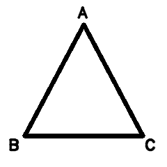</td>
    <td align="center">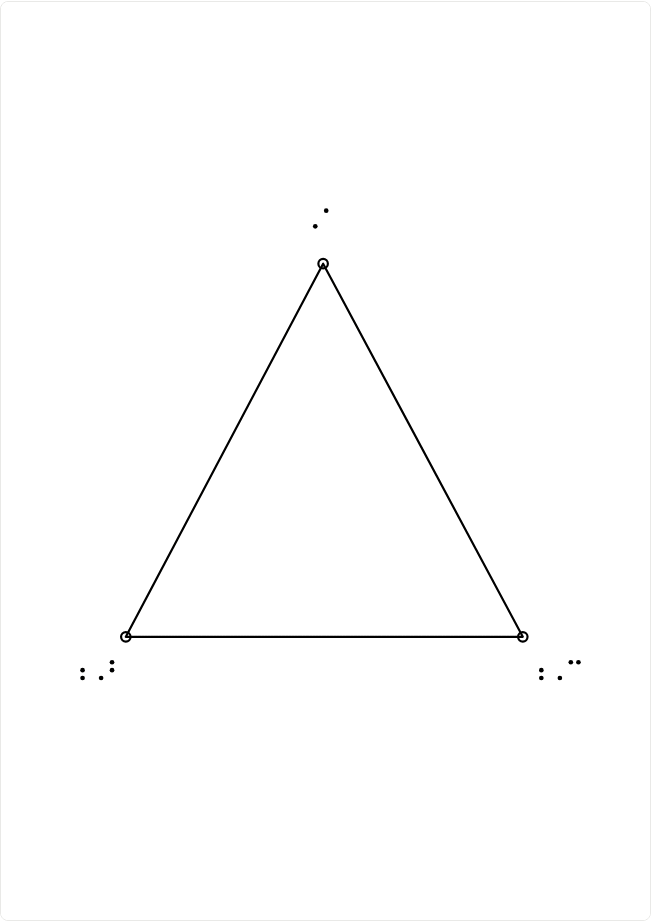</td>
  </tr>
</table>

<sub>A real run of the live pipeline on the repository's sample
<code>backend/app/demo_samples/labelled_triangle_worksheet.png</code>. It is a clean
example. Photos, dense worksheets and small labels often need teacher correction
(see <a href="#limitations">Limitations</a>).</sub>

**[Download for Windows](#windows-desktop-app)** ·
**[How to use it](#how-to-use-tactilegeo)** ·
**[Run from source](#run-from-source-development)** ·
**[Architecture](#architecture)**

## Contents

- [What TactileGeo does](#what-tactilegeo-does)
- [How to use TactileGeo](#how-to-use-tactilegeo)
- [Template Demo](#template-demo)
- [Windows desktop app](#windows-desktop-app)
- [Run from source (development)](#run-from-source-development)
- [Architecture](#architecture)
- [Technology](#technology)
- [Evaluation](#evaluation)
- [Limitations](#limitations)
- [Privacy and network use](#privacy-and-network-use)
- [Further documentation](#further-documentation)

## What TactileGeo does

```text
Image → quality check → Model A (geometry + OCR) → Model B (optional) → fusion
      → tactile simplification → Braille + layout → QA gate → teacher review → SVG
```

| Stage | What happens |
|---|---|
| Quality check | Reports size, brightness, noise and contrast problems with the uploaded image. |
| **Model A** | Deterministic OpenCV and OCR. Finds lines, circles, polygons, points, markers and text labels, with a confidence and a reason for each. It owns every coordinate in the output and needs no network or credentials. |
| **Model B** (optional) | A vision-language model on OpenRouter describes what the diagram means and proposes relationships. Its findings are suggestions: it never supplies coordinates or SVG. It runs only when enabled and a key is configured. |
| Fusion | Compares Model B's findings with Model A's elements: agreements, conflicts and Model-B-only items. Only findings the teacher accepts and applies change the output, and only on Model A's elements. |
| Tactile simplification | Removes noise and merges duplicates within a tactile feature budget, recording why each change was made. |
| Braille and layout | Translates labels with Liblouis (UEB Grade 2, `en-ueb-g2.ctb`) and places them on an A4 page. |
| QA gate | Checks for overlaps, unlabelled features, density and other problems. Critical problems block export. |
| Teacher review | The teacher corrects types, labels, positions and associations, then exports. |

## How to use TactileGeo

### 1. Open TactileGeo

- **Windows:** install the [desktop app](#windows-desktop-app) and start it from the
  Start Menu. While the local engine starts (up to a minute the first time), the
  upload button stays disabled. Template Demo can be used meanwhile.
- **Browser:** run the backend and frontend [from source](#run-from-source-development)
  and open http://localhost:5173.

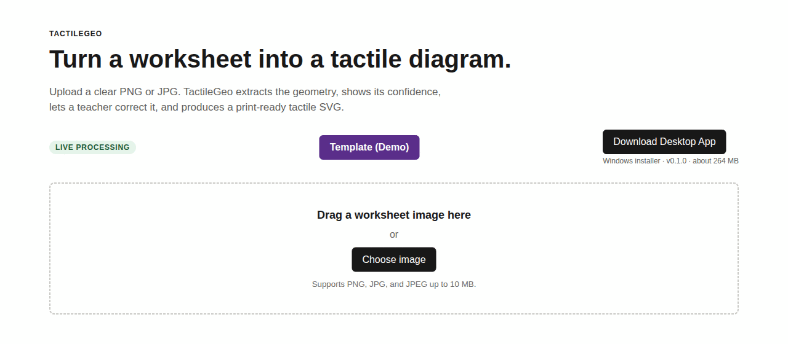

### 2. Choose an image

Click **Choose image** or drag a file onto the drop area. The backend accepts
**PNG, JPG and JPEG up to 10 MB** and rejects other types. A flat scan cropped to one
figure works best.

### 3. Create the tactile preview

Click **Create tactile preview**. Model A runs on the backend (about 3–10 s per
image on a laptop CPU). The summary bar then shows image quality, the number of
elements, how many need review, and the readiness score.

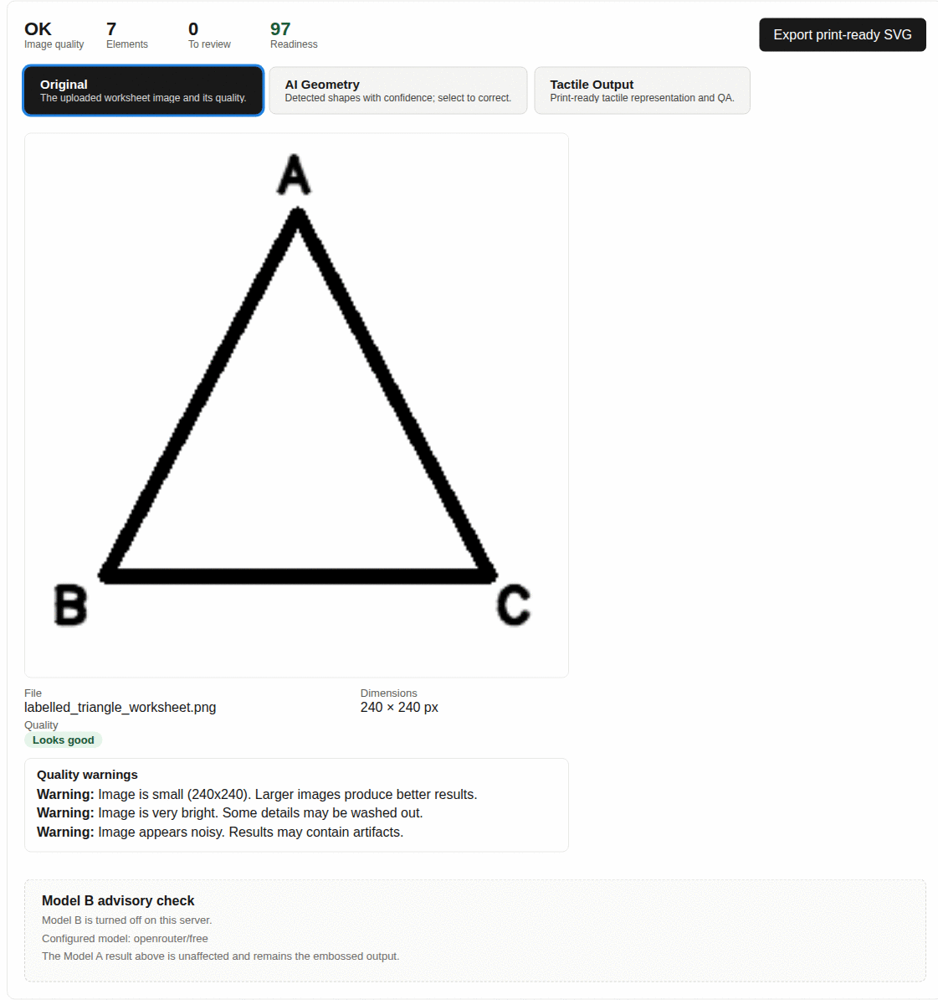

*Original tab: the uploaded image and its quality warnings. This sample is small
(240×240), and the app says so.*

### 4. Inspect the detected geometry

The **AI Geometry** tab overlays what Model A found on the image. The **Detected
elements** list shows each element with its confidence. Selecting one opens the
**Element inspector**, which explains why it was detected, its measured properties
and its relationships (for example "Point el_1 is a vertex of el_0").

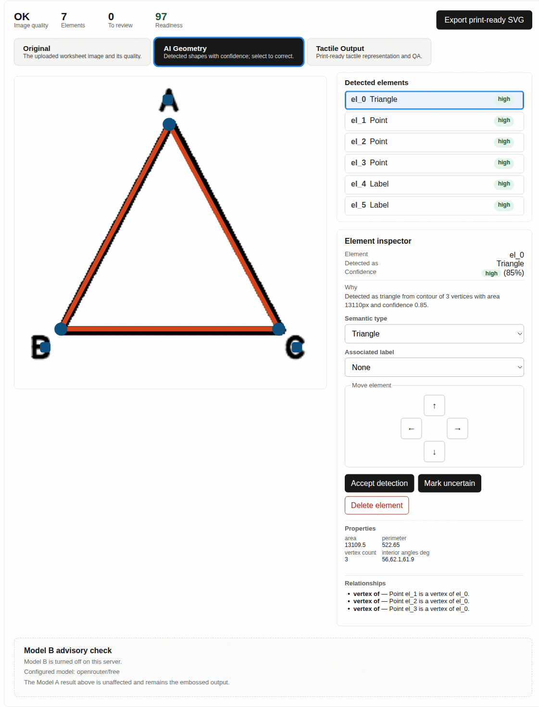

### 5. Correct the diagram

In the inspector the teacher can:

- change the **semantic type**;
- edit a label's **text**;
- set or change which element a label is **associated** with;
- **move** an element with the arrow buttons;
- **accept** a detection or **mark it uncertain**;
- **delete** an element.

Every edit recompiles the tactile output, Braille and QA.

**Model B (optional).** When the server has Model B enabled, the **Model B advisory
check** panel has a **Run Model B check** button. The teacher accepts or rejects each
finding and applies the accepted ones. When Model B is off (as in these screenshots)
the panel says so, and Model A's result is unaffected.

### 6. Check the tactile output and QA

The **Tactile Output** tab shows the A4 tactile preview, the readiness score, QA
warnings and a list of how the diagram was created.

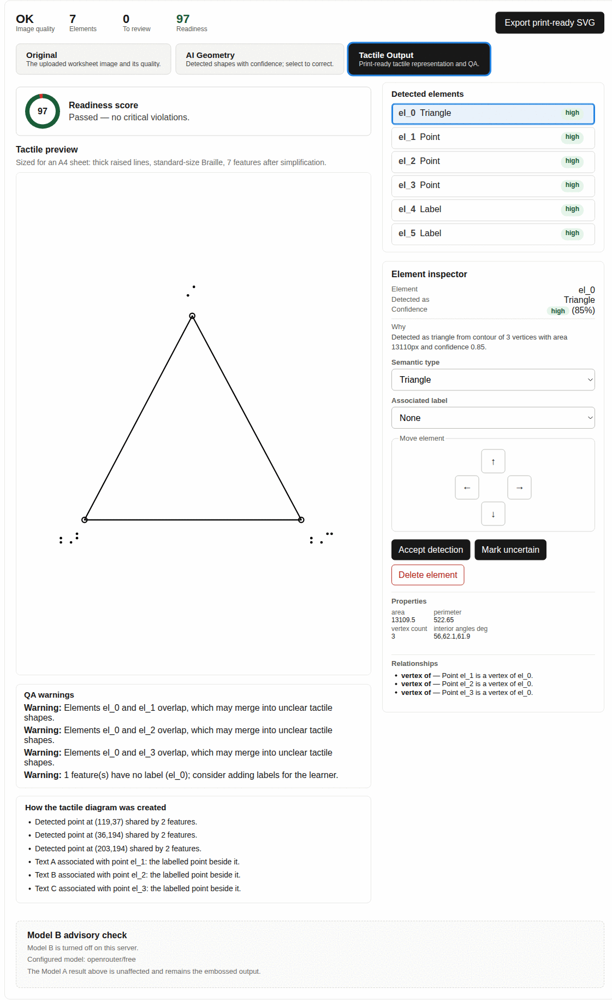

The readiness score and QA are software checks. A valid SVG with a high score
does not show that a blind learner can read the graphic easily by touch; that needs
testing with tactile readers.

### 7. Export

Click **Export print-ready SVG**.

- **Browser:** the file downloads as `tactile-<session id>.svg`.
- **Desktop:** a Save dialog lets you choose where it goes.

If QA found a critical problem, the button is disabled and a **Print-ready export
blocked** panel lists the reasons. There is no "export anyway" option. Fix the
problems in the editor and the export unlocks.

## Template Demo

**Template (Demo)** walks through all seven stages for one pie chart. Every stage
was **computed ahead of time** by the real pipeline (Model B's answer was recorded
from one live OpenRouter call). Browsing it sends nothing to the server or to an AI
service, so it works offline. It shows one successful example and is not a
live result.

| Model B (recorded) | Braille layout |
|---|---|
| 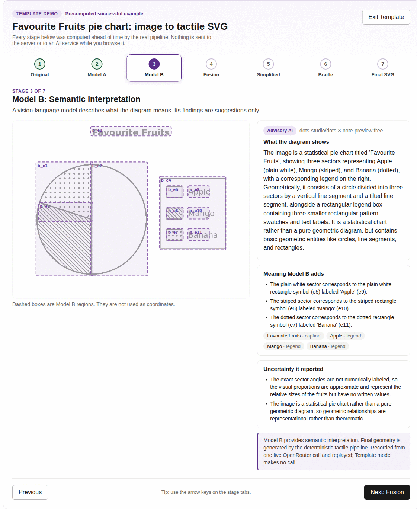 | 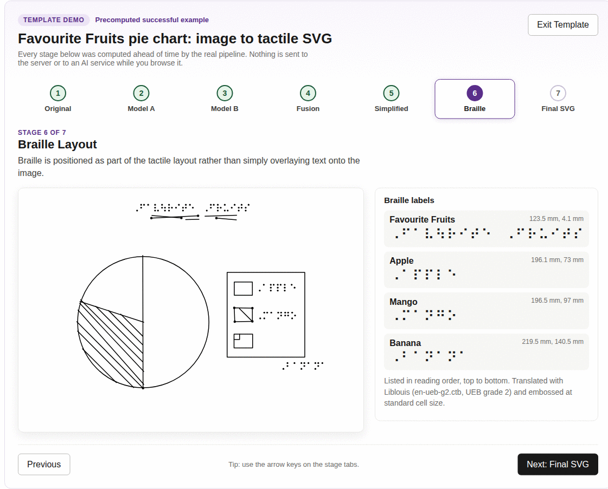 |

<details>
<summary>All seven Template stages</summary>

1. 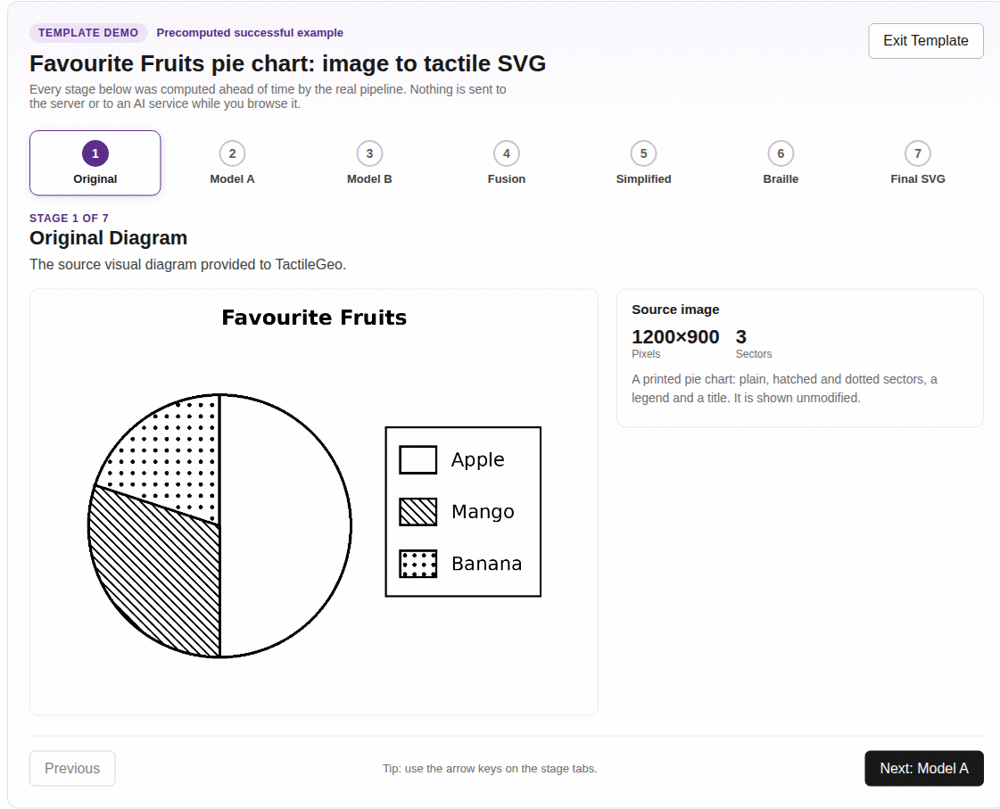
2. 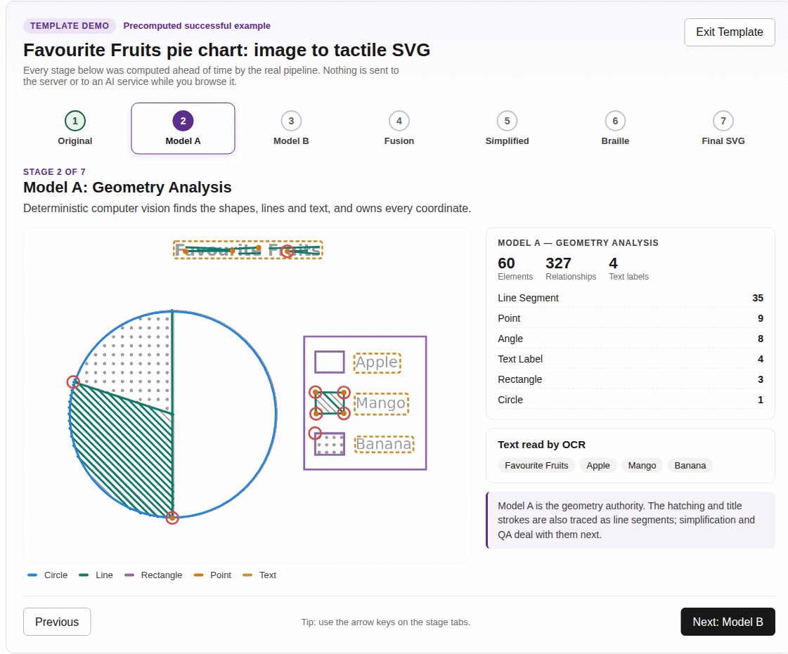
3. 
4. 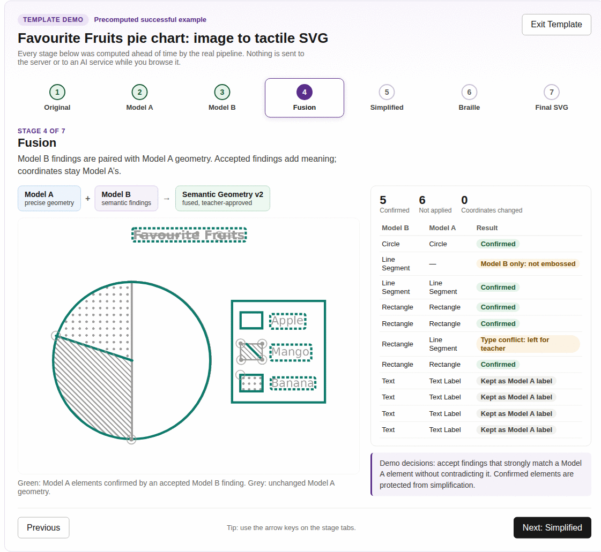
5. 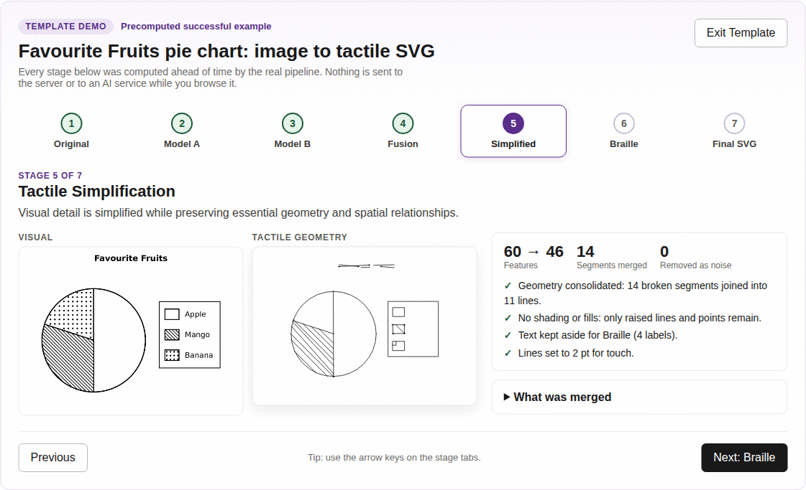
6. 
7. 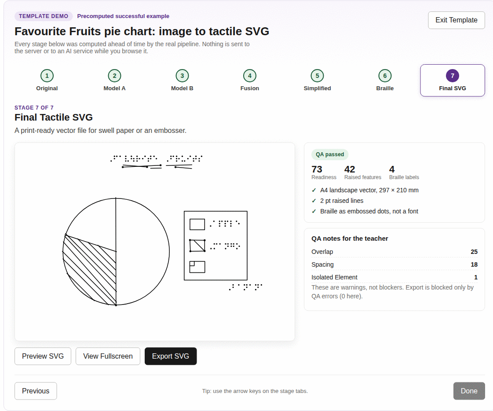

</details>

## Windows desktop app

| | |
|---|---|
| Download | [`TactileGeo-Setup.exe`](https://github.com/bharathkrishna0/Tactile-Geo/releases/download/v0.1.0/TactileGeo-Setup.exe) ([release page](https://github.com/bharathkrishna0/Tactile-Geo/releases/tag/v0.1.0)) |
| Version | 0.1.0 |
| Size | 264 MB download, about 800 MB installed |
| System | Windows 10/11, 64-bit (x64), about 2.5 GB free RAM while processing |
| Checksum | `SHA256SUMS.txt` on the release page |

The installer bundles the frontend, the backend with its own Python runtime,
OpenCV, PyTorch (CPU), the EasyOCR models, and Liblouis with its Braille tables.
GitHub Actions builds it, then installs it on a Windows machine with Python, Node.js
and Rust removed from `PATH`, processes a worksheet, and uninstalls it. **It has not
yet been tested on a clean laptop.** That CI machine already had WebView2 and the
Visual C++ runtime.

<!-- Screenshot needed: docs/images/desktop-app.png, the installed app window on Windows. Not captured yet (no Windows machine in the build environment). -->

**Install**

1. Download `TactileGeo-Setup.exe`. Optionally check it in PowerShell:
   `Get-FileHash .\TactileGeo-Setup.exe` and compare with `SHA256SUMS.txt`.
2. Run it. It is not code-signed, so Windows SmartScreen may warn: choose
   **More info → Run anyway**.
3. It installs for the current user, in `%LOCALAPPDATA%\TactileGeo`, with a Start Menu shortcut.

**First launch:** wait until "Starting the local TactileGeo engine…" ends and
**Choose image** becomes clickable. Images and logs are kept in
`%LOCALAPPDATA%\org.tactilegeo.desktop\`.

**Model B in the desktop app:** enter your own OpenRouter key under **Model B key**.
It is stored in Windows Credential Manager, never in the installer or the page.
Restart the app after saving it. Model B needs internet.

**Uninstall:** Settings → Apps → TactileGeo → Uninstall.

**Troubleshooting**

| Problem | What to do |
|---|---|
| SmartScreen blocks the installer | More info → Run anyway (the installer is unsigned). |
| Installer stops at WebView2 | WebView2 is missing and is downloaded during install: connect to the internet once. |
| "The local engine stopped during startup" or "did not respond within 3 minutes" | Click **Open logs folder** (also under the Help menu) and check `backend.log` and `backend-console.log`. |
| Processing is very slow or the app closes | Close other programs; processing uses about 2.5 GB of RAM. |
| Model B says unavailable | No key is saved, or there is no internet. Model A still works. |

Full details: [docs/desktop/README.md](docs/desktop/README.md), including the
clean-machine test plan.

## Run from source (development)

### Backend

Linux/macOS (Python 3.11+, Debian/Ubuntu shown):

```bash
sudo apt-get install liblouis-data python3-louis tesseract-ocr
cd backend
python3.11 -m venv .venv && . .venv/bin/activate
pip install -r requirements-torch-cpu.txt   # CPU-only PyTorch: skips ~4 GB of CUDA libraries
pip install -r requirements.txt -r requirements-dev.txt
ln -s /usr/lib/python3/dist-packages/louis "$(python -c 'import sysconfig; print(sysconfig.get_paths()["purelib"])')/louis"
uvicorn app.main:app --reload --port 8000
```

Windows:

```powershell
cd backend
py -m venv .venv
.\.venv\Scripts\Activate.ps1
pip install -r requirements.txt
uvicorn app.main:app --reload --port 8000
```

Check it with `curl http://localhost:8000/api/health` (returns `{"status":"ok"}`).

Without `DATABASE_URL` sessions live in process memory (development only).
Set it to a Postgres URL and run `python scripts/migrate.py` for durable
sessions, edits, audit events, and Model B jobs. Model B configuration
(`MODEL_B_ENABLED`, `OPENROUTER_API_KEY`, ...) is described in [AGENTS.md](AGENTS.md).

### Frontend

```bash
cd frontend
npm install        # Windows PowerShell: npm.cmd install
npm run dev        # http://localhost:5173, proxies /api to :8000
```

### Tests and builds

```bash
cd backend && pytest
cd frontend && npm test && npm run typecheck && npm run build

# STEM benchmark (48 synthetic cases with exact ground truth)
cd backend
python benchmarks/stem/generate.py
python scripts/benchmark.py --out benchmarks/stem/results/after.json
```

The Windows installer is built by
[`.github/workflows/desktop.yml`](.github/workflows/desktop.yml) on pull requests
that touch desktop files, on manual runs, and on `v*` tags (which publish a release),
or locally with `scripts/build_desktop.ps1` (see
[docs/desktop/README.md](docs/desktop/README.md)).

### Updating the download button after a release

The header's **Download Desktop App** button reads `frontend/src/desktopRelease.ts`.
It stays disabled ("not been published yet") while `url` is `null`. When a new
release with `TactileGeo-Setup.exe` is published, set `url` to
`https://github.com/bharathkrishna0/Tactile-Geo/releases/download/<tag>/TactileGeo-Setup.exe`,
set `version` and `sizeBytes` from the release page, and redeploy the frontend.
Non-https URLs are ignored, so a local file can't be linked by mistake. Update the
table under [Windows desktop app](#windows-desktop-app) at the same time.

### Braille runtime

Braille uses the official Liblouis `louis` Python bindings with the
`en-ueb-g2.ctb` table. The Docker image and the Windows installer include Liblouis
and its tables. Windows development needs a native Liblouis installation plus its
official Python bindings; the unrelated PyPI package named `louis` is not a
Liblouis binding.

### OCR engines

EasyOCR reads all text. Tesseract is an optional second engine: it re-reads the
short label crops (vertex letters, tick numbers) that EasyOCR's detector misses,
and the two readings are fused (agreement, per-engine confidence, and whether the
text is a plausible maths label) into one label that records which engine(s)
produced it. Install the binary with `sudo apt-get install tesseract-ocr`
(Docker image: included) or, on Windows, the UB Mannheim installer
(https://github.com/UB-Mannheim/tesseract/wiki) with `tesseract.exe` on `PATH`.
If the binary is missing, the pipeline silently runs EasyOCR only. The desktop
installer does not include Tesseract.

## Architecture

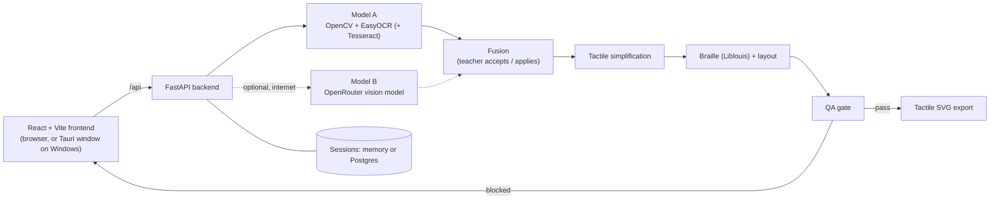

- **Frontend** (`frontend/`): upload, the three views, the element inspector, the
  Model B panel and export. In the desktop app the same build runs in a Tauri window.
- **Backend** (`backend/app/`): `services/pipeline.py` runs Model A;
  `model_b/` holds the OpenRouter client, the strict schema and validator, fusion,
  and `semantic_v2.py`, which applies teacher-accepted findings to a copy of
  Model A's elements (never coordinates).
- **Desktop** (`desktop/src-tauri/`): a Rust shell that starts the packaged backend
  on a free `127.0.0.1` port, waits for `/api/health`, and stops it when the window closes.

The boundary between the two models is described in [PROJECT.md](PROJECT.md)
section 17 and [AGENTS.md](AGENTS.md).

## Technology

| Area | Used |
|---|---|
| Frontend | React, TypeScript, Vite, Vitest, axe accessibility tests |
| Backend | Python 3.11, FastAPI, Uvicorn, Pydantic |
| Vision and OCR | OpenCV, EasyOCR (PyTorch, CPU), optional Tesseract |
| Braille | Liblouis, UEB Grade 2 |
| Semantic model | OpenRouter (optional) |
| Storage | In-memory, or Postgres (e.g. Supabase) |
| Desktop | Tauri 2 (Rust), PyInstaller, NSIS, GitHub Actions |

What is distinctive is the split of responsibilities. Deterministic computer
vision measures the geometry, an optional language model adds meaning, the teacher
decides which suggestions to accept, and a tactile compiler builds the output from
structured geometry rather than tracing the image. Every simplification records
its reason, so the teacher can see what changed.

## Evaluation

Accuracy is measured on 100 generated maths images with exact ground truth
(`math100-v1`), with a held-out test split, and reported in
[docs/evaluation/ACCURACY_REPORT.md](docs/evaluation/ACCURACY_REPORT.md) and the
iteration reports beside it. These are machine metrics on synthetic images, not a
real-world accuracy figure. No study with blind learners has been run yet; the
planned protocol is in
[docs/evaluation/HUMAN_EVALUATION_PROTOCOL.md](docs/evaluation/HUMAN_EVALUATION_PROTOCOL.md).

## Limitations

- OCR and geometry detection make mistakes, especially on phone photos, low-contrast
  scans, dense worksheets and small or slanted labels. Expect to correct some diagrams.
- Dense diagrams can exceed the tactile feature budget, so simplification can drop
  lines; QA may then block export until the teacher simplifies the page.
- Model B is optional, needs internet and an OpenRouter key, and free models are
  often slow, rate-limited or return no usable answer.
- The Template Demo shows precomputed results for one example.
- Readiness and QA are software checks. They are not certification against any
  tactile-graphics standard, and tactile usability needs testing with blind readers.
- The Windows installer is unsigned and has not yet been tested on a clean laptop.

## Privacy and network use

- **Model A, OCR, Braille, QA and SVG** run on the TactileGeo backend. In the
  desktop app that backend is on your own computer and works offline. In the
  browser version it is whichever server runs the backend, and the uploaded image is
  sent to that server.
- **Model B**, when enabled and run, sends the image to OpenRouter and the model
  provider it routes to. Do not use it for images that must not leave your machine.
- **Template Demo** sends nothing.
- Uploaded images are stored by the backend (`uploads/`, or
  `%LOCALAPPDATA%\org.tactilegeo.desktop\uploads\` in the desktop app).
- API keys stay on the backend or in Windows Credential Manager. They are never
  part of the frontend.

## Further documentation

- [Releases](https://github.com/bharathkrishna0/Tactile-Geo/releases)
- [docs/desktop/README.md](docs/desktop/README.md): desktop build, CI, clean-machine test plan
- [docs/VERCEL.md](docs/VERCEL.md): hosting on Vercel + Render + Supabase
- [docs/LAPTOP_TUNNEL.md](docs/LAPTOP_TUNNEL.md): zero-cost demo hosting (Vercel + laptop + Cloudflare Tunnel)
- [docs/DEPLOYMENT.md](docs/DEPLOYMENT.md): production deployment
- [docs/FINAL_REPORT.md](docs/FINAL_REPORT.md): architecture and measured results
- [PROJECT.md](PROJECT.md): product requirements
- [AGENTS.md](AGENTS.md): Model B configuration and contributor notes

There is no license file in this repository yet.
